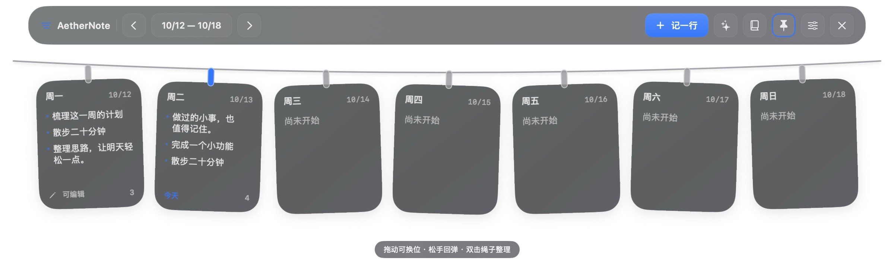
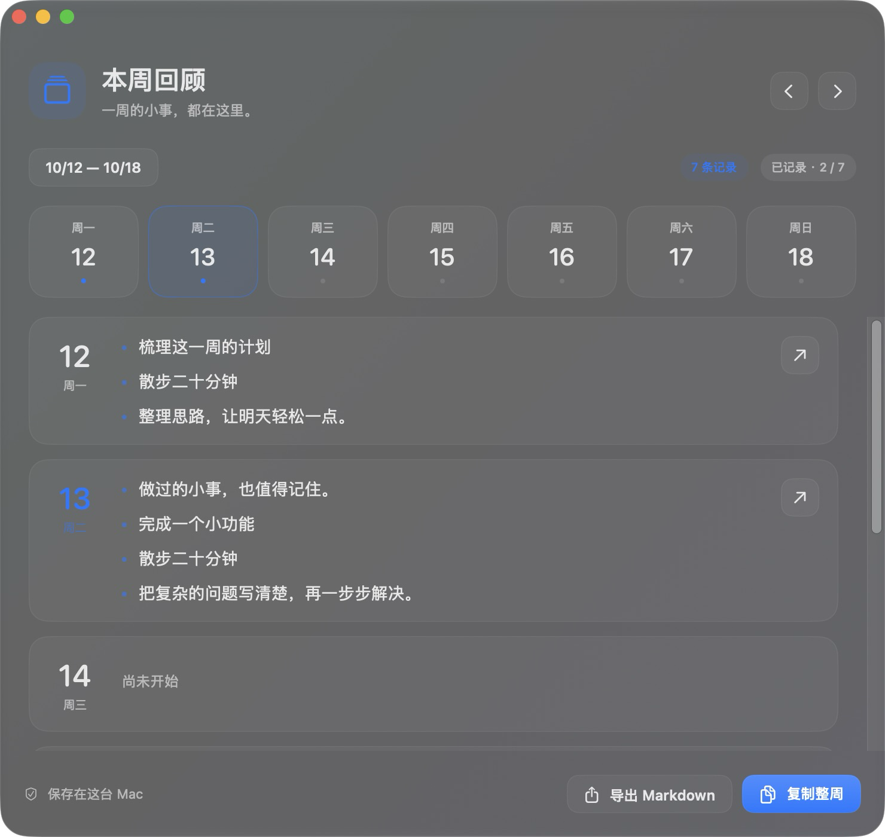

# AetherNote

**把做过的小事，挂在这一周的晾衣绳上。**

A small, native macOS journal. One note per day, up to seven on a playful clothesline. Write throughout the day, and return to any past day to add or edit.

[下载 / Download](https://github.com/bcblr1993/AetherNote/releases/latest) · [English guide](docs/guide-en.md) · [测试与发布](docs/verification.md)



<details><summary>本周回顾 · 原生界面截图</summary>



</details>

## 功能

- **随手记一行**：回车追加，Shift + 回车换行；粘贴多行会分成多条记录。今天和历史日期都可以补充、修改和删除。
- **每天都可编辑**：历史便签也能随时补充、修订或删除内容；跨过午夜仍可继续编辑原来的日期。未来日期到当天再开始记录。
- **一周一条晾衣绳**：默认周一到周五，可显示周末；周末已有记录或当天为周末时自动显示，最多七张。旧周可以翻阅。
- **拖动与整理**：左右拖动换位，上下拉动回弹，拖绳子也有弹性；一键或双击绳子按日期整理。拖动不会改变日期或正文。
- **三种材质、三种语言**：Liquid Glass、暖色纸张、极简纸张；简体中文、English、日本語，默认跟随系统。
- **原生玻璃**：macOS 26+ 使用 `NSGlassEffectView`，macOS 27 保留原生玻璃材质与弹性拖动动画；旧系统使用原生磨砂材质。尊重系统减少动态效果、降低透明度与增强对比度。
- **安静的每小时提醒**：一小时没有记录后，只改变菜单栏小标记。无声音、无自动窗口、不抢焦点；睡眠后重新计时，输入时延后，可关闭。
- **本周回顾**：七天导航、记录统计与按日分组，点击日期定位，直接返回任意便签编辑；可复制整周或导出 Markdown。
- **统一的玻璃界面**：紧凑工具栏、清晰的记录卡片与输入区、分组设置；切换日期或关闭窗口前保护未保存的修改。
- **应用内更新**：设置或菜单中的“检查更新…”会显示新版信息，下载后点击安装并重新启动。更新包经过签名校验，默认不自动检查、下载或重启。
- 本地保存、草稿自动保存、完整 JSON 备份、菜单栏入口、全局快捷键、可选登录启动。

## 安装与使用

发布的二进制适用于 **Apple Silicon（M 系列）Mac，macOS 14 或更新版本**。完整 macOS 27 玻璃效果需要 macOS 27。Intel 暂不提供预编译包。

1. 从 Releases 下载 DMG，将 AetherNote 拖到 Applications。
2. 打开应用，点击菜单栏便签图标；首次启动会展开晾衣绳。点今天，记下做过的事情。
3. `⌃⌥N` 打开今天的输入窗口；`⌃⌥L` 展开或收起。也可以将鼠标移到屏幕顶部中央。
4. 固定按钮让晾衣绳保持显示。未固定时鼠标离开后收起。
5. 右键卡片可向左/右移动；右键菜单栏图标可打开设置或退出。

> v0.1.1 起，历史便签不再封存。旧版数据无需转换，更新后即可编辑；修改保留记录原始创建时间和所属日期。

> v0.1.0 / v0.1.1 没有更新器，需要手动安装一次 v0.1.2；之后可在应用内完成后续更新。更新窗口跟随系统语言。

## 数据与隐私

日记在本地保存，不上传内容、不收集使用数据，无账号、云同步或 AI 服务。手动检查更新时会访问官网更新清单；下载更新时连接 GitHub。请求包含正常网络信息和应用/系统兼容信息，不包含日记正文、草稿或备份。

数据目录：`~/Library/Application Support/AetherNote/`

- `journal.json`：正文、日期元数据、显示顺序。
- `journal.previous.json`：最近一次成功写入之前的版本（不是长期历史备份）。
- `drafts.json`：尚未提交的草稿，跨日后可以带到今天。
- `preferences.json`：外观和提醒偏好。

写入使用原子替换，目录/文件权限为 700/600，单写入进程锁避免重复实例覆盖。读取损坏的正文文件会报错并保留原文件，不会自动清空。建议定期通过设置导出完整备份。恢复方法见 [English guide](docs/guide-en.md#backup-and-recovery)。

## 构建

SwiftUI + AppKit + Swift Package Manager；唯一生产依赖为 Sparkle 2.10.0，用于签名验证、安装和重启更新。推荐 Xcode 27；Xcode 26 使用其 SDK 可用的原生玻璃效果。

```sh
swift test
python3 scripts/check-localization.py
bash scripts/build-app.sh
open build/AetherNote.app
```

独立演示数据（不会写入正式日记目录）：

```sh
open build/AetherNote.app --args --data-dir "$PWD/work/demo" --demo --show
```

`--demo` 只在显式传入的数据目录为空时生成样例。`--editor`、`--review`、`--settings` 可用于打开对应界面。

## 设计来源与许可

晾衣绳的交互意象受到 [Tendedero](https://github.com/alejandrobujan/tendedero) 启发。AetherNote 是独立编写的日记产品，没有复制其源码或素材。

MIT License · AetherNative
